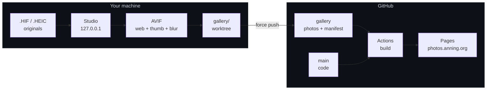
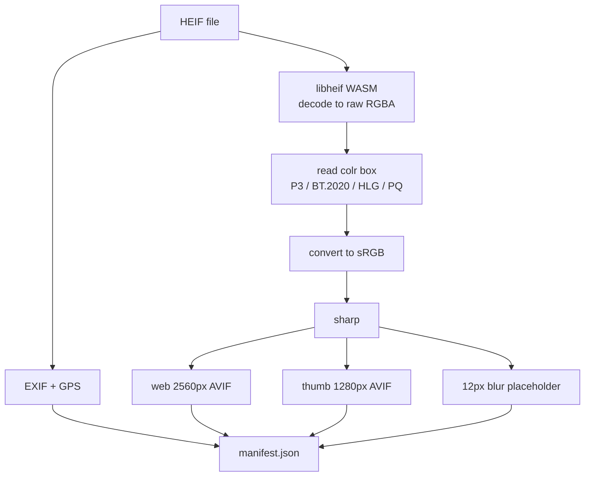
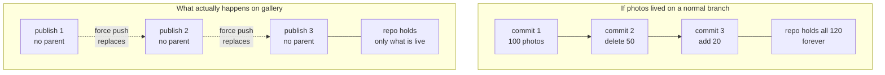

# photos

A private-ish photo gallery for family. Drag `.HIF` files from a Sony A7R V or `.HEIC` from an
iPhone into a local studio app, it compresses them to AVIF, pushes to GitHub, and a couple of
minutes later they are live at <https://photos.anning.org>. Runs entirely on free tiers.

---

## How it fits together

Nothing runs on a server. The studio is a local app that does the expensive work on your machine
and commits the results; GitHub only ever builds a static site out of what it is given.



The two branches are built together: the workflow checks out `main` for the site code and
`gallery` for the photos, then splices them in `scripts/collect.mjs`.

### What happens to one photo



---

## Daily use

Double-click `start.cmd` on Windows or `start.command` on a Mac. The studio opens in a browser.

| Step | What you do | Notes |
| --- | --- | --- |
| 1 | Drag photos in | Originals never leave the machine |
| 2 | Pick a quality tier | Applies to this batch, see below |
| 3 | Wait for decoding | Untick anything you do not want; fix orientation with the rotate buttons |
| 4 | Name the album, publish | GitHub Actions rebuilds; live in a minute or two |

Every long operation shows its milestones in the corner (checking GitHub, copying photos,
saving a snapshot, uploading with a percentage), so a stall is visible and a failure says how far
it got. Errors give a plain explanation and what to do, with a **Technical details** block that
can be copied into a bug report.

Nothing is lost by closing the window part-way. Photos already copied in or processed reappear on
the next start, and a publish that was cut off is either confirmed (if GitHub had already received
it) or rolled back so it can simply be run again.

### Setting up a new computer

Clone the repository (or copy the folder) and double-click the start script. On first run it
installs what is missing — Node.js and git through winget on Windows, or through Homebrew on a Mac
(installing Homebrew itself if needed, which asks for your Mac password) — then the npm
dependencies, then downloads the gallery that is already on GitHub. It also talks to GitHub once
in the terminal window, which is when a new machine signs in.

A folder copied from another operating system is fine: the image library is native code, and the
start script notices it was built for the wrong platform and reinstalls it.

If macOS will not open `start.command` (for example after copying the folder from Windows, which
drops the executable bit), run it once from Terminal: `bash start.command`. Without the start
scripts, `npm start` does the same setup and then launches the studio.

The bar in the top right is the GitHub Pages quota. The budget is 800 MB by default and the hard
Pages ceiling is 1 GB — **exceeding it makes deployment fail**, so delete old albums under
**Manage** before you get close.

### Quality tiers

Chosen per batch, because encoding happens the moment you press process. Measured on one 61 MP
Sony frame, total of the 2560 px web image plus the 1280 px thumbnail:

| Tier | AVIF quality | Per photo | vs standard | Photos in 800 MB |
| --- | --- | --- | --- | --- |
| Standard | 66 / 55 | 332 KB | — | ~2,450 |
| High | 75 / 60 | 441 KB | +33% | ~1,850 |
| Max | 84 / 66 | 583 KB | +76% | ~1,400 |

Those counts come from a single night shot, which compresses better than a detailed daylight
scene — treat them as an upper bound rather than a promise.

Thumbnails are 1280 px so a phone's single column (about 1100 device pixels wide on an iPhone)
stays sharp. Thumbnails published at an older, smaller size are rebuilt from the web image by
`node scripts/regen-thumbs.mjs` (close the studio first).

The tier is recorded alongside the staged file, so re-encoding one photo with the rotate button
does not silently drop it back to standard.

### What visitors download

**Download** in the site header fetches every photo of the album being viewed (all of them under
**All**). On a phone or tablet it then offers **Save to Photos**, which opens the system share
sheet; on a computer it saves one ZIP, with a folder per album under **All**. The lightbox's
download button saves the single photo.

The files are the same 2560 px AVIFs the site shows, named by shooting time
(`2026-10-02 10.37.29.avif`). They carry the shooting time, camera, lens and exposure in their
EXIF, so Photos files them on the day they were taken, but never GPS. iOS 16+, macOS 13+, Android
12+ and current desktop browsers open AVIF; Windows needs the free AV1 extension in older builds.

Photos published before this EXIF was added get it from `node scripts/backfill-exif.mjs` (close
the studio first). It edits only the files' metadata, not their pixels, and publishes the result.

---

## Privacy boundary

Read this once. The protection here is **a soft gate, not encryption**.

| Property | Status |
| --- | --- |
| Indexed by search engines | No — `robots.txt` plus `noindex` on every page |
| Passcode before any photo loads | Yes — not one thumbnail is requested until it is entered |
| Passcode checked on a server | **No** — it is checked in the browser |
| Photo files themselves protected | **No** — they sit in a public repository |

Anyone who guesses or is given a direct image URL bypasses the gate entirely, as does anyone who
reads the page source. The repository has to be public because GitHub does not offer Pages on
private repositories for free accounts.

If you ever want a real login, deploy `dist/` to Cloudflare Pages behind Cloudflare Access
(also free, up to 50 users). No site code would need to change.

**Location data is stripped by default.** GPS coordinates are only written when you tick
"show this album's location" at publish time, per album. Leave it off for anything shot at home.

---

## Why the photos are not on `main`

Git keeps every version of every file it has ever committed, so a photo deleted from a normal
branch frees no space at all. The photos therefore live on an orphan branch that is replaced
wholesale on every publish:



The repository is therefore always exactly as large as the current gallery, and pushes stay cheap
because git deduplicates by content hash. Two consequences worth knowing:

- **Locally**, the overwritten objects linger. **Manage → Reclaim local disk** runs
  `git reflog expire` plus `git gc --prune=now` to drop them.
- **On GitHub**, unreachable objects are not deleted immediately either. Someone who recorded a
  commit SHA could still fetch it until GitHub runs its own garbage collection. Deleting a photo
  is not a recall.

### Publishing from more than one machine

Because every publish is a force-push of a parentless commit, git has no ancestry with which to
protect you: publishing from a machine that missed someone else's upload would silently delete
their photos. The studio therefore remembers what GitHub held the last time this machine synced
(`refs/studio/synced`) and checks GitHub before every publish, delete or settings change:

| GitHub vs this computer | What happens |
| --- | --- |
| Same, or only this computer changed | Publishes normally |
| Only GitHub changed | Brings GitHub's photos in first, then publishes on top — no question asked, nothing is lost |
| Both changed | Stops before touching anything and shows which albums differ, then lets you choose |

The three choices when both changed:

- **Keep both** — take GitHub's gallery, re-apply what this computer added or deleted since it
  last synced, then add this change.
- **Overwrite GitHub with this computer** — the dialog names every album this would remove from
  the site.
- **Cancel** — nothing changes anywhere; photos waiting to publish stay in the studio.

The answer only counts for the GitHub state you were shown: the push uses `--force-with-lease`, so
if another publish lands while you are deciding, you are asked again rather than overwriting it.

Any failure after the check — GitHub rejecting the push, the network dropping, the studio being
closed — rolls the gallery back to exactly where it started, so there is never a "published"
state that GitHub did not receive. A commit that did get made but never reached GitHub (from an
older version of the studio, say) is detected on start, and the studio offers to upload it.

A machine that predates this tracking has no record of its last sync, so for its first conflict
the studio cannot tell "added here" from "deleted there". **Keep both** then keeps every album from
either side. If you know this computer is simply out of date, make it match GitHub instead:

```sh
git -C gallery fetch origin gallery
git -C gallery reset --hard FETCH_HEAD
```

---

## Layout

| Path | What lives there |
| --- | --- |
| `start.cmd` / `start.command` | Double-click to launch on Windows / macOS; installs Node, git and deps if missing |
| `config.json` | Title, budget, passcode hash, quality tiers |
| `MANIFEST.md` | Data contract for `manifest.json` |
| `studio/` | The local upload app — never deployed |
| `site/` | Astro static site; this is what ships |
| `gallery/` | Photos + manifest, a worktree of the `gallery` branch |
| `scripts/` | Setup (`bootstrap.*` install Node and git, `prepare.mjs` does the rest), the post-build collect step, and the tests |

`npm test` runs every test that can run on the machine: the site build against the fixtures, the
studio's publish flow, and a two-computer sandbox (a local bare repository standing in for GitHub)
covering conflicts, rollbacks and crash recovery. With Chrome or Edge installed it also clicks
through the conflict dialog, error display, album download and lightbox in a headless browser. The decoder tests
also run when camera files are present in `samples/`. None of them touch the real gallery or push anywhere.

Each module under `studio/lib/` opens with a header comment explaining what it is for and why it
works the way it does. Those comments are the reference for decoding, colour handling,
orientation, concurrency and the git plumbing; this README deliberately does not restate them,
so that there is only one copy to keep true.

**Known scaling limit.** The home page is one static HTML document carrying roughly 1 KB per photo,
mostly the inline blur placeholder. A few hundred photos is 200–400 KB and entirely fine; past a
thousand or so the page approaches 1 MB and would need pagination or lazy loading.

---

## Troubleshooting

| Symptom | Fix |
| --- | --- |
| Site did not update | Check the repository's Actions tab. A failure in `collect` usually means the 1 GB quota was exceeded |
| Photo is sideways | Use the 90° / 180° / 270° buttons on the card; that one photo is reprocessed |
| Deployment rejected, site too large | Delete old albums under **Manage**, then **Reclaim local disk** |
| Out of memory while processing | Set `"concurrency": 1` in `config.json` |
| Passcode change did not take effect | Save under **Manage → Site settings**; that publishes immediately. Family must enter the new passcode |
| Publish stopped with "GitHub has changes this computer does not have" | Another machine published. See *Publishing from more than one machine* above |
| "GitHub refused to let this computer push" | Sign in once from a terminal: `git push origin main` (on a Mac, `gh auth login && gh auth setup-git`) |
| `bad interpreter: /bin/bash^M` on a Mac | The scripts lost their line endings in a copy; re-clone, or run `git checkout -- .` |
